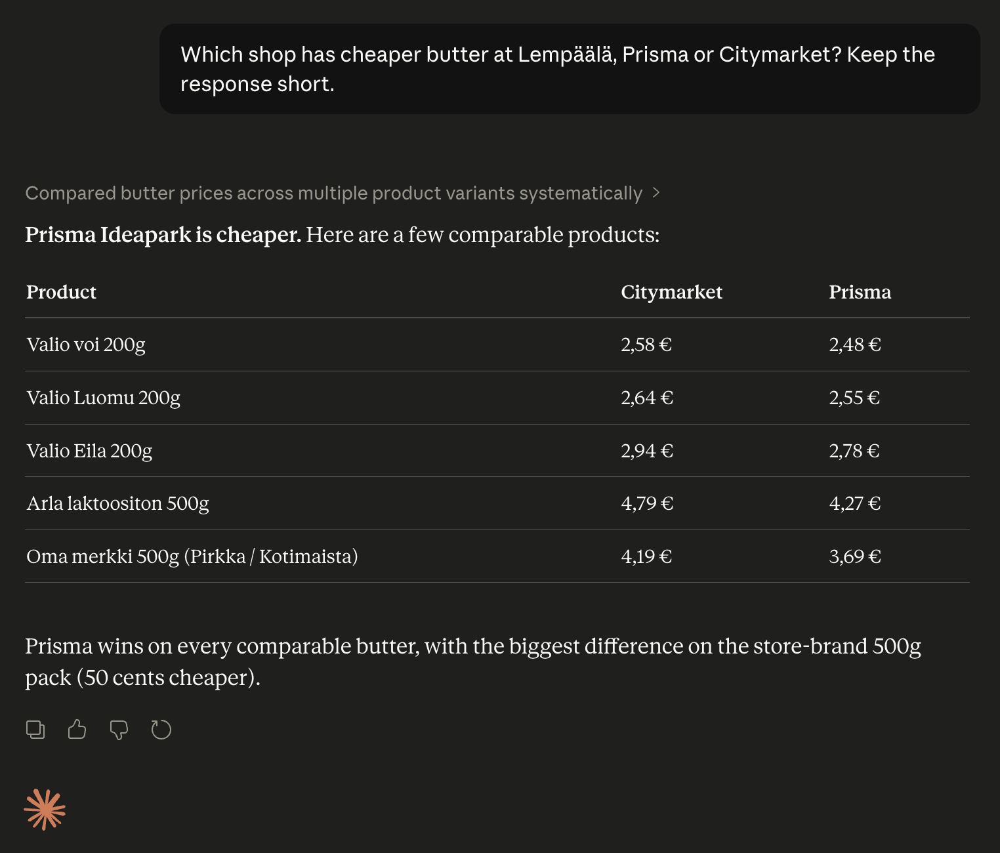
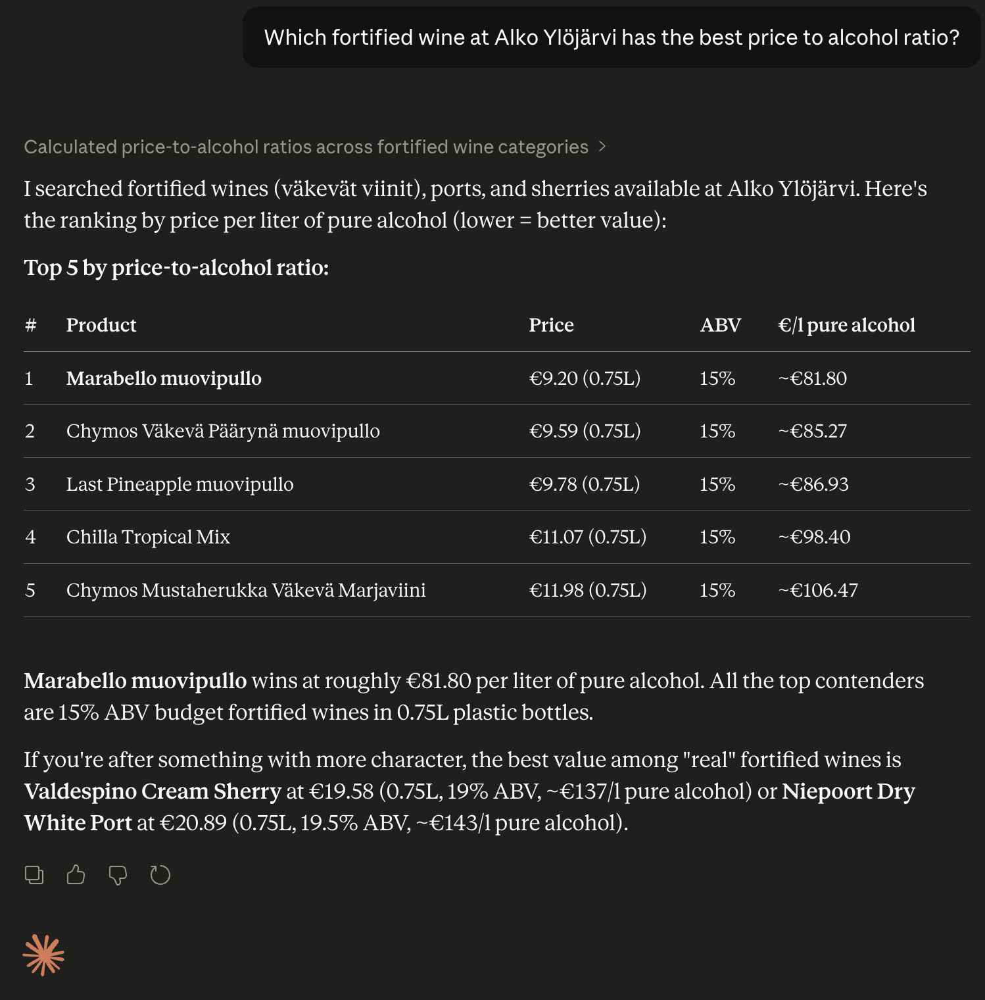

# Muona

MCP server for **S-Etukortti purchase receipts** ([s-etukortti.fi](https://s-etukortti.fi)):
fetches a logged-in S-ryhmä member's receipts, bonus and discount data, keeps a local
SQLite purchase history, and reads and edits S-ostoslista shopping lists. It also includes Finnish
grocery and alcohol product search:

- **S-Etukortti** — Playwright persistent profile with a manually established email-OTP
  login; API calls share the profile's HttpOnly session cookies and a CSRF token
  sniffed from the page's own traffic
- **S-ostoslista** — the SOK shopping-list app's GraphQL API, signed in through the same
  S-tunnus session; lists move between the phone and Muona via share links
- **K-Ruoka** — Playwright browser with stealth plugin (Cloudflare Turnstile bypass)
- **S-Kaupat** — Direct HTTP with persisted GraphQL query hashes (extracted via Playwright)
- **Alko** — Direct HTTP with NextAuth guest session (no browser needed)

Muona is a single-user personal tool: it reads only the logged-in user's own data,
and every human authentication step (captcha, one-time code, strong authentication)
stays manual.

## Credits

Muona started as a fork of [mcp-ruoka](https://github.com/p18a/mcp-ruoka) by
[Panu Linnala (p18a)](https://github.com/p18a). A large part of the code is his: the MCP
server and its HTTP/stdio transports, OAuth and bearer authentication, the shared
browser session, and the K-Ruoka, S-Kaupat and Alko product search. Muona adds the
S-Etukortti, S-ostoslista and purchase-history parts on top. Thank you, Panu!

## S-Etukortti login (email OTP, human in the loop)

The receipt tools need a login session in the persistent browser profile
(`.browser-data-s-etukortti/`, override with `S_ETUKORTTI_DATA_DIR`).

**Agent-driven flow (primary).** The connected agent establishes the session through
MCP tools, relaying every human step to the user:

1. Agent asks the user for their email and calls `s_etukortti_login_start`.
2. If a captcha challenge appears, the tool returns the captcha image; the agent shows
   it to the user and passes their answer to `s_etukortti_login_captcha`.
3. The service emails a one-time code; the user reads it from their inbox and tells the
   agent, which calls `s_etukortti_login_otp`. The agent never reads the inbox itself.
4. At least on a fresh browser profile, the service then requires strong authentication
   (Telia broker: S-Pankki, Mobiilivarmenne, other banks). Bank credentials and PINs
   must never pass through the chat — Mobiilivarmenne is the recommended method: the
   agent relays only the phone number (`s_etukortti_login_strong_auth` +
   `s_etukortti_login_strong_auth_phone`), tells the user the verification code shown
   on the page (tapahtumatunniste), and the user approves with their PIN on their own
   phone while the agent polls `s_etukortti_login_strong_auth_wait` (call it in short
   chunks; Telia may error transiently — resubmitting the phone number retries).
   **Without Mobiilivarmenne (bank login):** the agent calls
   `s_etukortti_login_remote_screen`, which returns a noVNC link to a live view of the
   login browser, reachable only from the owner's Tailscale devices. The user opens it
   on their phone, picks the bank and types the credentials directly into the bank page,
   approves in the bank app, and the agent keeps polling
   `s_etukortti_login_strong_auth_wait`. The screen closes by itself when the login
   leaves `awaiting_strong_auth` or after `S_ETUKORTTI_REMOTE_SCREEN_MINUTES` (15).
5. Done — the session lives in the persistent profile. A background keepalive refreshes
   it every `S_ETUKORTTI_KEEPALIVE_HOURS` hours (default 6) for as long as the server
   runs, and `s_etukortti_session_status` is the cheap health check the agent should
   call periodically; when it reports `loggedIn: false`, the agent restarts the login
   flow with the user.

**CLI fallback.** `bun run login` drives the same state machine interactively in a
terminal (captcha image is saved to `screenshots/captcha.png`). The browser profile is
locked to one process, so this works only while the server is stopped; normally log in
through the MCP tools above.

The OTP and captcha steps are deliberately manual and must never be automated. The
profile directory is equivalent to a live login session: it is gitignored and should be
kept out of unencrypted backups (`chmod 700`).

## Tools

- **search_products** — Search products by query. Supports all three chains. `storeId` required for K-Ruoka/S-Kaupat, optional for Alko (national catalog).
- **get_stores** — List stores, optionally filtered by city and/or chain.
- **get_receipts** — List S-Etukortti receipts (id, store, time, total) for a date range; defaults to the current month.
- **get_receipt** — One receipt with the raw printed text plus parsed line items (name, price, weight/quantity, unit price, campaign discounts).
- **get_bonus_summary** — Monthly bonus percentage, benefit amounts, purchase totals and the co-op's bonus level table.
- **get_benefit_totals** — Accumulated benefits (bonus, fuel discount, surplus) over a month range.
- **get_discounts** — Campaign discounts received, per month and per purchase.
- **s_etukortti_session_status** — Cheap health check: is the receipt session valid, current login phase, last keepalive result.
- **s_etukortti_login_start / _captcha / _otp / _cancel** — Step-by-step email-OTP login driven by the agent with the human answering the captcha and the emailed code.
- **s_etukortti_login_strong_auth / _strong_auth_phone / _strong_auth_wait** — Strong-authentication step (Mobiilivarmenne recommended); approval happens on the user's own device.
- **s_etukortti_login_remote_screen / _remote_screen_close** — Tailnet-only live view of the login browser for bank-credential strong auth; auto-closes.
- **s_ostoslista_status / get_shopping_lists / get_shopping_list / get_past_products / search_shopping_list_products** — S-ostoslista (SOK shopping-list app) via its GraphQL API. Logs in by itself through the S-Etukortti S-tunnus session while it is alive (once per call, 20 min cooldown after a failed flow); otherwise the human finishes the S-Etukortti login.
- **create_shopping_list / add_shopping_list_items / update_shopping_list_items / remove_shopping_list_items / delete_shopping_list** — edit S-ostoslista lists. Items are free text or store products by EAN plus product name (matched in a store search for the name, since the API's EAN lookup is not open to this client; an EAN not found aborts the write). To add a product, search it with search_shopping_list_products and pass the result's ean and name. An item already open on the list (same EAN or same text) is not added twice but reported back, as are near matches. Never places orders; Scan & Go, shelf-label blinking and recommendation feedback are left out on purpose.
- **share_shopping_list / claim_shared_shopping_list** — move lists between the phone and Muona with share links (`https://s-ostoslista.fi/liity/<id>`); see [S-ostoslista lists and sharing](#s-ostoslista-lists-and-sharing).
- **sync_receipts** — Downloads receipts into the local SQLite purchase-history database (`data/receipts.sqlite`, `MUONA_DB_PATH`).
- **search_purchases** — Searches the local purchase history by item name, date range and store (no network).
- **purchase_history_stats** — Local history coverage: receipt/item counts, date range, totals.

## Local purchase history

Long-term history lives in SQLite (`bun:sqlite`, file `data/receipts.sqlite`). Backfill or
top up with `bun run sync --start YYYY-MM-DD --end YYYY-MM-DD` (defaults to the last ~2
months) or the `sync_receipts` MCP tool; syncs are idempotent and only fetch missing
receipt details. The receipt-text parser is verified against every synced receipt
(`parser_ok` column; grocery, fuel-pump and EV-charging formats supported).

## S-ostoslista lists and sharing

S-ostoslista lists belong to the app's **anonymous device identity**, not to the S-tunnus
login: the phone app and Muona each have their own, so with the same login they still see
different lists (verified live). Purchase-history data such as `get_past_products` follows
the S-tunnus; lists do not.

- **Phone → Muona:** in the app, share the list (Jaa) and give the link — or the whole
  "Sinulle on jaettu S-ostoslista: …" message — to `claim_shared_shopping_list`. Muona then
  sees and edits the same list as the phone.
- **Muona → phone:** `share_shopping_list` returns a link; open it on the phone.

Muona's device identity is the `anonymousToken` in `data/s-ostoslista-tokens.json`
(`S_OSTOSLISTA_TOKEN_PATH`). It is fetched once and never replaced — a new one would orphan
every list Muona owns or has joined — so back that file up with the rest of `data/`. An
unreadable token file is moved aside as `….corrupt-<timestamp>` rather than overwritten; if
its anonymous token could not be salvaged, the S-ostoslista tools refuse to fetch a new one
until you copy the `anonymousToken` back into the token file or delete the kept file to
start over with an empty identity.

## Running as a service

Run the HTTP server under a process manager (e.g. a systemd unit with
`WorkingDirectory` set to the repo and `ExecStart=bun run src/index.ts`). Set `PORT` and
`MCP_AUTH_TOKEN` in `.env` (bearer auth). The startup warmup re-opens the S-Etukortti
session from the persistent profile and starts the keepalive.

Optional remote login screen (bank strong auth), bound to localhost and exposed only over
a private network such as a Tailscale tailnet:

- Run a virtual display, e.g. `Xvfb :<display> -screen 0 480x960x24` (phone-shaped), as a
  service tied to the main one.
- Give the server `DISPLAY=:<display>`, `S_ETUKORTTI_SCREEN_SIZE=480x960` (the S-Etukortti
  browser then runs headed on that display) and `S_ETUKORTTI_REMOTE_SCREEN_URL` (the
  public HTTPS origin of the viewer).
- Expose websockify/noVNC (port 6080) privately, e.g.
  `tailscale serve --bg --https=<port> http://127.0.0.1:6080`. x11vnc (port 5901) and
  websockify/noVNC only run while a screen is open. Packages: `xvfb x11vnc novnc websockify`.

## Install as Claude Code plugin

Requires [Bun](https://bun.sh) installed.

```
/plugin marketplace add midnight-builds/mcp-muona
/plugin install muona@muona
```

Dependencies and Playwright browser are installed automatically on first load.

## Connect via stdio

Runs the server as a subprocess — simplest option for local use.

```bash
git clone https://github.com/midnight-builds/mcp-muona.git
cd mcp-muona
bun install
```

Then add to your MCP client config:

```json
{
  "mcpServers": {
    "muona": {
      "command": "bun",
      "args": ["run", "/path/to/mcp-muona/src/index.ts", "--stdio"]
    }
  }
}
```

## Connect via Streamable HTTP

Run the HTTP server (see [Running as a service](#running-as-a-service)) and point your MCP
client at it:

```json
{
  "mcpServers": {
    "muona": {
      "type": "streamable-http",
      "url": "https://<your-host>/mcp",
      "headers": {
        "Authorization": "Bearer <MCP_AUTH_TOKEN>"
      }
    }
  }
}
```

For direct bearer token auth, set `MCP_AUTH_TOKEN` in `.env` and use it in the header
above. For OAuth (e.g. claude.ai), configure `OAUTH_CLIENT_ID` and `OAUTH_CLIENT_SECRET`
on both the server and your MCP client. Keep the server off the public internet unless
one of these is set.

## Local development

```bash
bun install
cp .env.example .env
bun run dev
```

The server runs on `http://localhost:3001/mcp` by default (Streamable HTTP). Pass `--stdio` for stdio transport.

## Environment variables

| Variable | Description |
|---|---|
| `OAUTH_CLIENT_ID` | OAuth client ID (required for claude.ai) |
| `OAUTH_CLIENT_SECRET` | OAuth client secret (required for claude.ai) |
| `MCP_AUTH_TOKEN` | Static bearer token (alternative to OAuth) |
| `PORT` | Server port (default: 3001) |
| `LOG_LEVEL` | pino log level (default: info) |
| `BROWSER_DATA_DIR` | Persistent browser data directory (default: `.browser-data/`) |
| `S_ETUKORTTI_SCREEN_SIZE` | e.g. `480x960`: run the S-Etukortti browser headed on `DISPLAY` at this size |
| `S_ETUKORTTI_REMOTE_SCREEN_URL` | Public (tailnet) base URL of the noVNC remote login screen |
| `S_ETUKORTTI_REMOTE_SCREEN_MINUTES` | Remote screen time limit (default 15) |
| `S_OSTOSLISTA_API_KEY` | AppSync API key shipped in the S-ostoslista app (in `.env`) |
| `S_OSTOSLISTA_TOKEN_PATH` | S-ostoslista token file (default `data/s-ostoslista-tokens.json`); holds the device identity that owns the lists — back it up |

## Usage examples





## License

[MIT](LICENSE). Original mcp-ruoka code © Panu Linnala; Muona additions © Midnight builds.

## Disclaimer

This project is unofficial and not affiliated with S Group (SOK), S-Etukortti, S-Kaupat,
K Group, K-Ruoka, or Alko. Product search uses publicly available data through their
websites; the S-Etukortti and S-ostoslista tools access only the logged-in user's own
account. Use responsibly.
